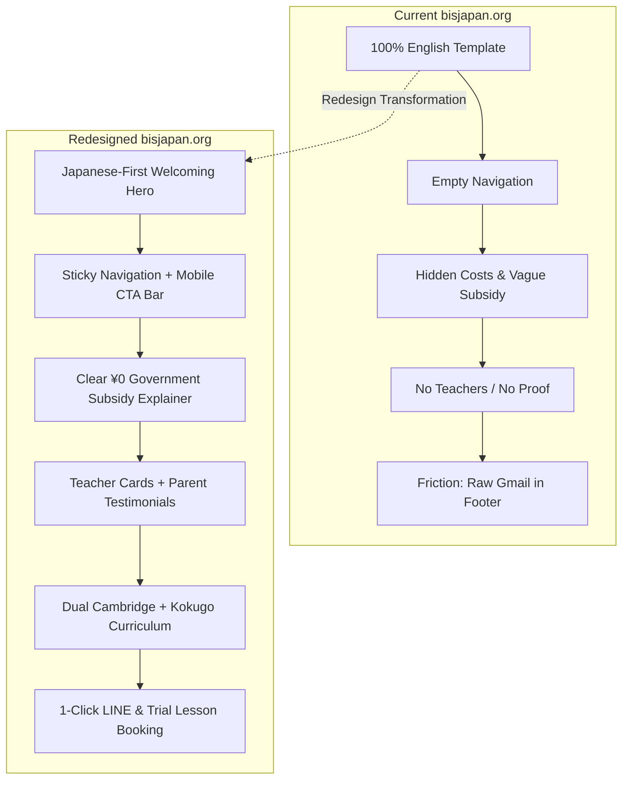

# Phase 1C: Competitive Gap Analysis (Diff: 1A vs 1B)
**Skill Used:** `competitive-platform-analysis` (Strategic Tension & Moat Mapping)  
**Target:** bisjapan.org UI/UX Redesign  
**Core Objective:** Systematically identify and rank every gap between top-performing school sites in Japan (1A) and the current bisjapan.org (1B), weighted by impact on attracting native Japanese parents.

---

## 1. Strategic Tension & Positioning Moat

In the Japanese education market, parents evaluating an English-medium school experience a fundamental tension:

$$\text{Global English Fluency} \quad \longleftrightarrow \quad \text{Japanese Cultural \& Academic Security}$$

- **The Competitor Trap:** Elite expat schools (BST, ASIJ) ignore this tension because their primary market is expatriate families paying ¥2.5M–¥3.5M/year in corporate subsidies. Domestic commercial chains (Kids Duo) offer only after-school daycare immersion without an accredited academic curriculum.
- **The BIS Japan Blue Ocean Moat:** BIS Japan offers a **Cambridge International Curriculum** with **official Japanese public school Kokugo textbooks**, fully eligible for **Japanese government pre-primary subsidies (幼保無償化)** at an accessible tuition of **¥0 ~ ¥35,000/month**. 
- **The Core Problem:** The current website communicates *none* of this value to Japanese parents.

---

## 2. Comparative Matrix: Top School Sites (1A) vs bisjapan.org (1B)

| Feature / Dimension | Best-in-Class School Sites in Japan | Current bisjapan.org | Gap Severity |
| :--- | :--- | :--- | :---: |
| **Primary Language Strategy** | Curated Japanese-first copy with native English toggle; empathetic, polite Japanese tone (`です・ます調`). | 100% English; zero Japanese guidance for local families. | 🚨 Critical (Blocker) |
| **Conversion Funnel** | Sticky mobile CTA bar with LINE Official Account, Free Trial Lesson Booking calendar, and 1-tap calling. | No inquiry forms; no trial booking; only raw email and landline in footer. | 🚨 Critical (Blocker) |
| **Subsidy Clarity** | Step-by-step visual infographic on *Yoji Kyoiku Mushouka* (幼児教育・保育の無償化: ¥37,000/月) reducing net tuition to ¥0~¥17,000. | Buried English lines (*"Mushouka: ¥37,000 − ¥37,000 = ¥0"*) with zero Japanese explanation. | 🚨 Critical (Blocker) |
| **Trust Signals & Faces** | Verified faculty photos, degrees, safety protocols, and native Japanese parent testimonials. | Completely anonymous; zero teacher photos; no testimonials; address typo (*abina Shi*). | 🚨 Critical (Blocker) |
| **Curriculum Pathway** | Dual-track roadmap: Cambridge International + Japanese public school curriculum, showing future high school/university pathways. | High-level bullet points without syllabi, grade comparisons, or future pathway mapping. | ⚠️ High Impact |
| **Local Geographic UX** | Station access breakdown (Ebina Station Odakyu / Sotetsu / JR), school bus route maps, parking details. | Plain text address with typo; bus mentioned vaguely as "within 5 km"; no interactive map. | ⚠️ High Impact |
| **Visual Aesthetics & Typography** | Modern, warm, purposeful design; crisp font pairing (`Noto Sans JP` + Humanist English Sans); high contrast. | 2014 ThemeForest template; washed-out `#a2a2a2` grey text; generic stock imagery. | ⚠️ High Impact |
| **Mobile & Performance** | Sub-2s LCP load time; touch-friendly cards; clean responsive layout with native pinch-zoom enabled. | 4.8s LCP; zoom blocked by viewport tag; tables overflow horizontally; 24 blocking scripts/styles. | ⚠️ High Impact |

---

## 3. Ranked Gap Analysis: Prioritized by Impact on Japanese Parents

The gaps are prioritized below according to their direct impact on resolving Japanese parent anxieties and driving school visit conversions:

### 🥇 Rank 1: The "Cultural Alienation" Gap (Language & Empathy Deficit)
- **What Top Sites Do:** Treat the Japanese parent as the hero of the story. Use comforting Japanese micro-copy:  
  *「英語が初めてのお子様も、保護者様が英語を話せなくてもご安心ください。確かな日本語力と世界基準の英語力を海老名で育みます。」*  
  (Rest assured even if your child is new to English or parents don't speak English. We nurture solid Japanese literacy alongside world-standard English in Ebina.)
- **What bisjapan.org Does:** Opens with irrelevant English slogans (*"Ideas are worth spreading"*).
- **Remediation Plan:** Build a bilingual architecture where Japanese is the default, primary experience, with an instant English toggle in the header.

### 🥈 Rank 2: The "Conversion Friction" Gap (No Low-Commitment Next Step)
- **What Top Sites Do:** Offer a frictionless 3-step entry point:
  1. **LINE Consultation (公式LINEで質問):** Japanese mothers prefer chatting on LINE without committing their email or phone number.
  2. **Free Trial Lesson / Campus Tour (無料体験レッスン・学校見学予約):** A simple date/time picker with 4 fields (Parent Name, Child Age, Preferred Date, Phone/LINE).
  3. **Direct Phone Call (電話でのお問い合わせ):** Visible on every mobile screen.
- **What bisjapan.org Does:** Forces parents to compose an email to a generic Gmail address (`bisjpn@gmail.com`).
- **Remediation Plan:** Implement a floating sticky CTA bar on mobile and dedicated conversion sections on every page.

### 🥉 Rank 3: The "Cost Transparency & Subsidy" Gap (The ¥0 Opportunity)
- **What Top Sites Do:** Make financial accessibility their strongest marketing weapon. A visual savings calculator explains:
  - Base Pre-Primary Tuition: ¥37,000 / month
  - Government Free-Childcare Subsidy (無償化給付): **−¥37,000 / month**
  - **Net Parent Out-of-Pocket: ¥0 / month**
- **What bisjapan.org Does:** Mentions "Mushouka" in English without citing the Child and Family Agency (こども家庭庁) regulations or explaining application eligibility for Ebina/Kanagawa residents.
- **Remediation Plan:** Create an interactive visual breakdown component with clear badges for *Mushouka* (無償化対象施設) and company subsidies.

### 4. The "Faceless Institution" Gap (Teacher Credibility & Safety)
- **What Top Sites Do:** Showcase the dedicated educators: native English teachers with international qualifications alongside certified Japanese teachers who manage daily Kokugo and pastoral care.
- **What bisjapan.org Does:** Zero mention of teachers, leadership, or staff.
- **Remediation Plan:** Create a "Meet Our Teachers / 講師・スタッフ紹介" component with warm, high-resolution portrait photos, nationality flags, credentials, and welcoming messages.

### 5. The "Bilingual Balance Proof" Gap (Academic Pathway Clarity)
- **What Top Sites Do:** Answer the inevitable question: *"Can my child enter a Japanese elementary/middle/high school later?"* by showing the dual syllabus:
  - **English Core:** Cambridge Primary & Lower Secondary (Math, Science, English, Computing).
  - **Japanese Core:** MEXT-approved Kokugo textbooks (光村図書 / 東京書籍 equivalent) taught by native Japanese educators.
- **What bisjapan.org Does:** Vaguely states "We use the same text books of Japanese language which are taught at Japanese Public Schools".
- **Remediation Plan:** Design a dual-curriculum comparison card displaying both academic pillars with clarity.

### 6. The "Local Accessibility & Transit" Gap (Ebina Commute Reality)
- **What Top Sites Do:** Detail exact door-to-door transit logistics:
  - Walking/bus routes from **Ebina Station (海老名駅)** (Odakyu Line, Sotetsu Main Line, Sotetsu-JR Direct Line).
  - School bus radius (Ayase, Ebina, Yamato, Atsugi within 5km).
  - Safe drop-off zone and parking spaces for parents driving by car.
- **What bisjapan.org Does:** Misspells Ebina as "abina" and fails to provide station transit directions.
- **Remediation Plan:** Implement an illustrated "Access & Bus Routes / アクセス・送迎バス" section with interactive Google Maps integration.

### 7. The "Technical Polish & Web Vitals" Gap (Speed & Modernity)
- **What Top Sites Do:** 90+ Lighthouse score, lightweight semantic HTML5, zero horizontal scroll, instant mobile response.
- **What bisjapan.org Does:** 10 render-blocking CSS sheets, Slider Revolution jitter, disabled zoom.
- **Remediation Plan:** Clean, dependency-free semantic HTML5 and modern CSS custom properties engineered for < 1s LCP.

---

## 4. Architectural Transformation Roadmap

