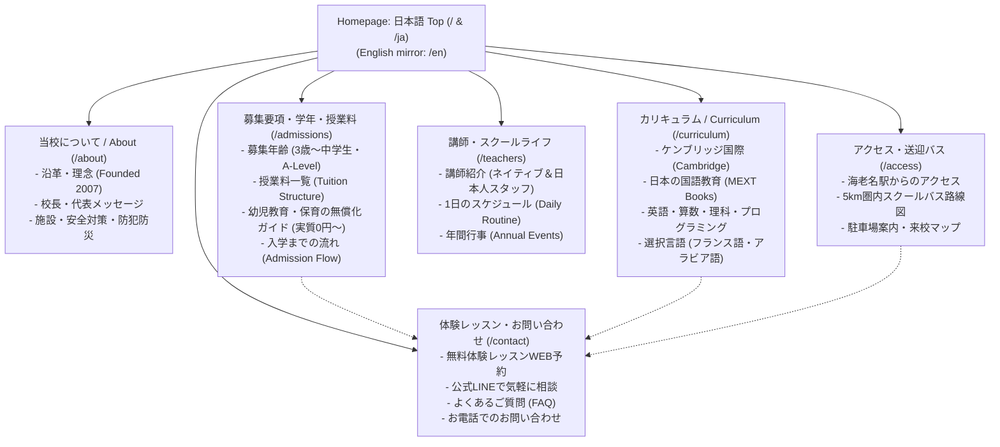

# Phase 3A: Information Architecture & Sitemap Specification
**Skill Used:** `seo` (Crawlability, Site Hierarchy & Local Japanese Search Intent)  
**Target:** bisjapan.org Redesign  
**Core Audience:** Native Japanese Parents in Ebina, Ayase, Yamato, Atsugi

---

## 1. Information Architecture Principles

1. **Shallow Click Depth ($\le 2$ Clicks):** A Japanese mother with a toddler in one hand must be able to reach any essential piece of information (tuition after subsidy, bus routes, trial booking) within two taps.
2. **Dual-Track Bilingual URL & Navigation Architecture:** Clean semantic routing with structured `hreflang` tags to capture both Japanese search volume (*"海老名 英語スクール"*, *"海老名 インターナショナルスクール"*, *"幼保無償化 海老名"*) and expat queries (*"British school Kanagawa"*, *"Cambridge curriculum Ebina"*).
3. **Friction-Free Primary User Flows:**
   - **Flow 1 (The Reassurance Seeker):** Home → "日本の教科書も学ぶ？" (Japanese Kokugo Proof) → Teacher Faces → Free Trial Booking.
   - **Flow 2 (The Financial Evaluator):** Home → "幼保無償化でいくら？" (Subsidy Calculator: ¥0~¥17k) → Schedule Visit.
   - **Flow 3 (The Busy Commuter):** Home → "バスはうちの近くに来る？" (5km Bus Map) → LINE Consultation.

---

## 2. Visual Sitemap Hierarchy



---

## 3. Detailed Route & Page Specification

| URL / Route | Primary Intent (Japanese Parent) | Key On-Page Content Elements | SEO Target Keywords | Conversion Goal |
| :--- | :--- | :--- | :--- | :--- |
| **`/` (or `/ja`)** | Primary entrance; quick reassurance, credential proof, and trial booking. | Hero reassurance banner, TrustBar, 3-step value pillars, Teacher preview, Subsidy callout, Testimonials, Sticky CTA. | 海老名 インターナショナルスクール, 海老名 英語スクール, 綾瀬 英語 幼稚園 | 無料体験レッスン予約 / LINE相談 |
| **`/about`** | School history, safety, and why it was founded in Ebina in 2007. | 2007年設立の歩み, 代表メッセージ, 施設紹介, 安全・衛生・アレルギー・防犯防災体制. | BIS Japan 海老名, 海老名 インター 評判 | 学校見学予約 |
| **`/curriculum`** | Proof that child masters English without falling behind in Japanese. | ケンブリッジ国際カリキュラムの特長, 日本の公立小中学校教科書（国語）の併用, 英語探究学習, 算数・理科・プログラミング. | ケンブリッジ プリスクール 神奈川, バイリンガル教育 国語 | 資料請求 / 授業見学 |
| **`/admissions`** | Transparent tuition schedule and government subsidy eligibility. | 年齢別クラス（Nursery/LKG/UKG/Grade 1〜6/Secondary）, 授業料表, 幼児教育・保育の無償化（月額3.7万円給付）の手続き・実質月謝0円〜解説. | 幼保無償化 インターナショナルスクール, 海老名 プリスクール 費用 | 無料体験レッスン予約 |
| **`/teachers`** | Who will be teaching and caring for my child? | 専任外国人講師（顔写真・出身国・教育資格・メッセージ）, 日本人バイリンガル担任, 職員研修・安全管理. | インターナショナルスクール 先生 海老名 | 体験レッスンで先生に会う |
| **`/access`** | How does my child commute safely every day? | 海老名駅東口からのバス・徒歩ルート, 自宅近くまで送迎するスクールバス運行エリア（海老名・綾瀬・大和・厚木 5km圏）, 駐車場完備案内. | 海老名 インター 送迎バス, 海老名市本郷 スクール | 見学・個別相談予約 |
| **`/contact`** | Frictionless inquiry and booking hub. | 3ステップ体験レッスン予約フォーム, LINE友だち追加リンク, 1タップ電話発信, 駐車場予約, FAQ. | 海老名 英語 体験レッスン | 体験予約完了 |

---

## 4. Technical SEO & Multilingual URL Architecture

### 4.1. Hreflang Configuration
```html
<link rel="alternate" hreflang="ja" href="https://bisjapan.org/" />
<link rel="alternate" hreflang="en" href="https://bisjapan.org/en/" />
<link rel="alternate" hreflang="x-default" href="https://bisjapan.org/" />
```

### 4.2. Local Search Metadata (Ebina & Kanagawa Geo-Targeting)
- **Primary Title Tag (JA):**
  `ブリティッシュ・インターナショナル・スクール｜海老名市のケンブリッジ認定バイリンガル校（幼児〜中等部）`
- **Primary Meta Description (JA):**
  `神奈川県海老名市・綾瀬市のブリティッシュ・インターナショナル・スクール（BIS Japan）。ケンブリッジ国際カリキュラムと日本の教科書による確かな国語教育を両立。幼児教育無償化対象で実質月謝0円〜。5km圏内スクールバス運行中。無料体験レッスン受付中。`
- **Canonical:** `https://bisjapan.org/`

### 4.3. Breadcrumb Navigation
All secondary pages implement semantic schema breadcrumbs:
`Home (ホーム) > 募集要項・授業料 (Admissions & Fees)`
